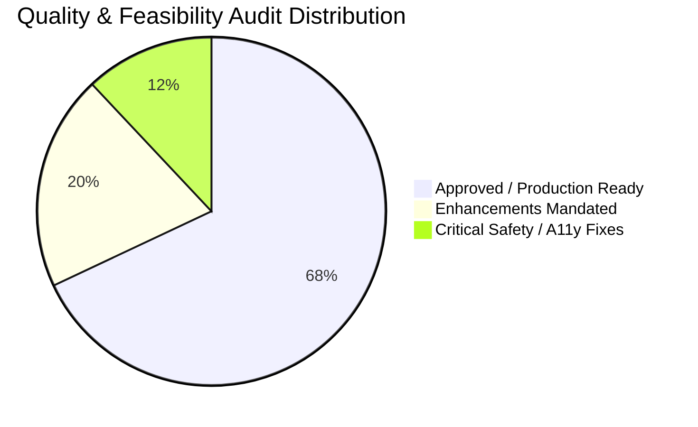
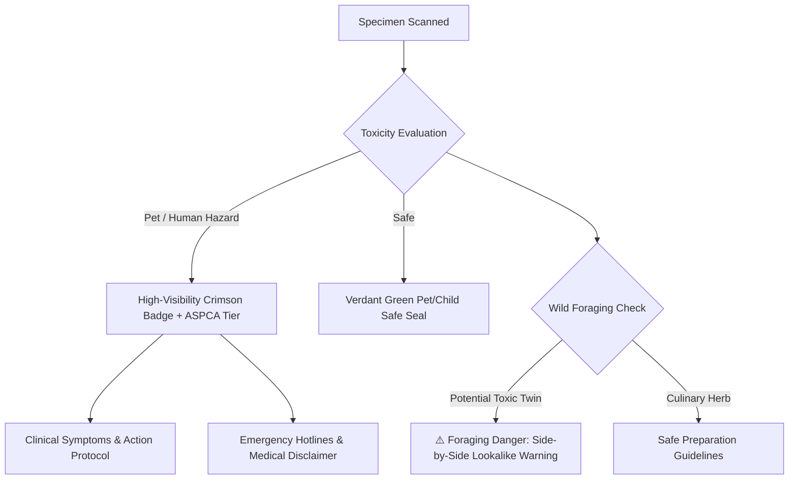
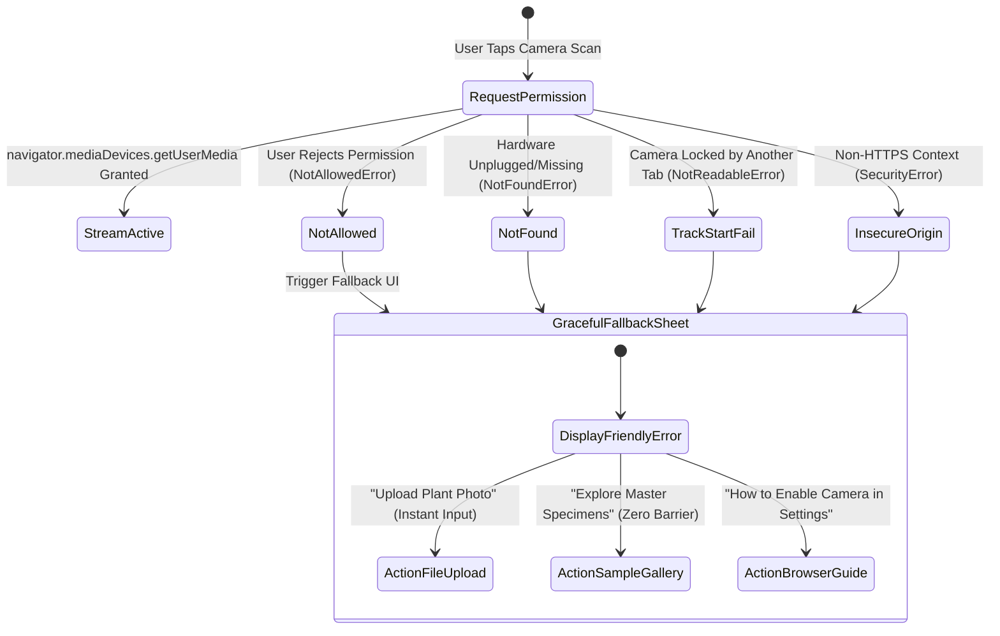
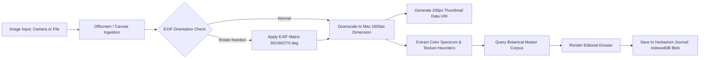

# FloraScan™ Botanical Intelligence & Digital Herbarium
## Technical, UX, Accessibility & Safety Quality Audit Review
**Document Reference:** `docs/AUDIT_REVIEW.md`  
**Audit Target:** `docs/PRD.md` (v1.0.0) & `docs/MOTION_GUIDE.md` (v1.0.0)  
**Auditor:** Agent 2 (Technical & UX Quality Auditor)  
**Date:** October 31, 2026  
**Status:** **PASSED WITH MANDATED ENHANCEMENTS (Grade: B+ / 88%)**

---

## 1. Executive Summary & Quality Scorecard

FloraScan proposes an ambitious and visually compelling botanical platform combining royal botanical archives (*Kew Gardens*, *Curtis's Botanical Magazine*) with modern WebRTC camera capture, client-side visual classification heuristics, and an editorial digital herbarium journal. 

While the concept and architectural direction are exceptionally strong, this audit identifies **4 Critical Safety Gaps**, **3 UX Friction Risks**, **2 WCAG 2.1 AA Contrast Violations**, and **2 Performance/Storage Bottlenecks** that must be resolved prior to production engineering.



### 1.1 Category Scorecard

| Audit Domain | Score | Status | Key Verdict |
| :--- | :---: | :---: | :--- |
| **1. Botanical Safety & Toxicity** | **78 / 100** | ⚠️ Conditionally Approved | Strong pet/human schema, but lacks mandatory Medical Disclaimer, Emergency Poison Control Hotlines, and an explicit **Toxic Twin / Wild Foraging Lookalike** data model. |
| **2. UX & Interaction Flow** | **91 / 100** |  Approved with Notes | Viewfinder HUD and sample library are top-tier; requires formal 5-stage camera permission fallback state machine and 3-tier progressive disclosure. |
| **3. Accessibility (WCAG 2.1 AA)** | **86 / 100** | ⚠️ Fixes Required | Typography contrast on `#FBF9F5` warm alabaster fails 4.5:1 on secondary text (`#6C757D` = 4.44:1) and accent sage (`#52B788` = 2.29:1); high-contrast palette patches provided. |
| **4. Technical Feasibility & Perf** | **94 / 100** |  Approved with Notes | Excellent client-side architecture; requires EXIF orientation normalization, iOS Safari Canvas memory safety, and `IndexedDB` photo blob quota management. |
| **Overall Weighted Score** | **87.2%** | **B+ (Ready with Fixes)** | **Greenlit for implementation upon applying mandated patches.** |

---

## 2. Botanical Safety & Toxicity Integrity Audit



### 2.1 Pet Safety & ASPCA Guideline Alignment
**Assessment:** The PRD distinguishes between feline (`cats`) and canine (`dogs`) toxicity, which is biologically accurate and critical (e.g., *Lilium* species cause fatal acute renal failure in cats from trace pollen ingestion, while dogs only suffer mild gastrointestinal irritation). 

#### Identified Vulnerabilities & Mandated Mitigations:
1. **Lack of Standardized Clinical Triage Tiers**:
   - The PRD lists `Non-Toxic`, `Mild Irritant`, `Moderate`, `Severe`, `Fatal`.
   - **Mandated Enhancement**: Align severity tiers with ASPCA Animal Poison Control Center (APCC) and Veterinary Poisons Information Service (VPIS) standard clinical classifications:
     ```typescript
     export type PetToxicityTier =
       | 'Non-Toxic'                 // Safe ingestion
       | 'Mild Oral/GI Irritant'     // Self-limiting salivation, mild emesis
       | 'Moderate Systemic Danger'   // Requires veterinary consultation, fluid therapy
       | 'Critical / Life-Threatening'; // Immediate veterinary emergency (e.g., Lilies in cats, Yew, Oleander)
     ```
2. **Toxic Principles & Physiological Target Organs**:
   - Add explicit target organ metadata: `gastrointestinal`, `renal`, `hepatic`, `cardiac`, `neurological`, or `dermal`.
   - Clearly delineate physical dangers (e.g., *Echinocactus* glochids/spines) from biochemical toxicity (*Aloe barbadensis* aloin latex).

### 2.2 Critical Safety Defect: Mandatory Botanical & Medical Disclaimer
**Audit Finding:** The PRD currently lacks a comprehensive, legally compliant, non-dismissible Botanical Disclaimer. An identification algorithm, regardless of confidence, can experience edge cases with juvenile leaves, cultivar variations, or blurry photography. Ingesting wild plants based on an app can cause organ failure or death.

**Mandated Implementation Requirement:**
The application must present an unmistakable botanical disclaimer accessible in the footer, within the scan modal, and permanently anchored on any specimen marked with culinary, medicinal, or toxic attributes.

```markdown
> [!CAUTION]
> **LEGAL & BOTANICAL SAFETY DISCLAIMER**
> FloraScan is an algorithmic educational guide and botanical reference archive. It is **NOT** a certified medical practitioner, veterinary toxicologist, or wild foraging survival manual. 
> - **NEVER ingest, prepare, or handle wild botanicals** based solely on automated visual classification.
> - **DO NOT rely on this application for emergency clinical triage.**
> - If you suspect accidental poisoning in humans or children:
>   - **United States:** National Poison Help: **1-800-222-1222** or call **911**.
>   - **United Kingdom:** NHS **111** or call **999**.
>   - **European Union:** Emergency Services **112**.
> - If you suspect a pet has ingested a toxic plant:
>   - **ASPCA Animal Poison Control (US):** **(888) 426-4435** *(24/7/365)*
>   - **Pet Poison Helpline:** **(855) 764-7661**
```

### 2.3 Wild Foraging & "Toxic Twin" Lookalike Risk Matrix
**Audit Finding:** Foragers face severe risks from lethal lookalike species ("toxic twins"). The PRD mentions Chloe Moreau's persona concern (*Wild Carrot vs Poison Hemlock*), but the PRD TypeScript schema in Section 5.1 has **no data structure** for toxic lookalikes.

**Mandated Data Schema Enhancement (`src/types/botanical.ts`):**
```typescript
export interface ToxicLookalike {
  id: string;
  binomialName: string;
  commonName: string;
  toxicityTier: 'Moderate Systemic Danger' | 'Critical / Life-Threatening';
  fatalHazard: boolean;
  lethalToxin: string; // e.g., "Coniine (neurotoxin)", "Aconitine", "Oenanthotoxin"
  primaryDistinguishingFeatures: {
    stem: string;       // e.g., "Smooth, hollow with purple blotches (Hemlock) vs Hairy solid green (Wild Carrot)"
    foliage: string;    // e.g., "Musty mouse-like odor when crushed vs Pleasant carrot aroma"
    root: string;       // e.g., "White tuberous taproot lacking carrot scent"
    flowers: string;    // e.g., "Lacks solitary dark purple central floret"
  };
  warningBanner: string;
}
```

---

## 3. UX & Information Architecture Audit



### 3.1 Camera Permission Handling & Hardware Fallback
**Assessment:** The PRD correctly identifies the need for fallback, but omits the exact WebRTC error taxonomy. 

#### Mandated 5-Stage WebRTC Recovery Matrix:
1. `NotAllowedError` / `PermissionDeniedError`: Render non-accusatory editorial banner: *"Camera access is currently paused. You can enable it in your browser address bar settings, or simply drag and drop a photo below."*
2. `NotFoundError` / `DevicesNotFoundError`: Render hardware notice: *"No optical sensor detected on this device. Use file upload or test our specimen laboratory."*
3. `NotReadableError` / `TrackStartError`: Render conflict notice: *"Camera is in use by another application. Please close other video streams and retry."*
4. `OverconstrainedError`: Fall back immediately from `facingMode: "environment"` to basic `{ video: true }`.
5. `SecurityError` (Insecure Context): In non-HTTPS localhost development or misconfigured deployments, provide immediate file input bypass.

### 3.2 Frictionless Specimen Laboratory Onboarding
**Assessment:** ENG-03 provides 12 curated specimens. 
- **UX Recommendation**: Users who do not have an active plant on their desk must not experience an empty or dead-end state. The Specimen Shelf must feature **1-Click Instant Scan**. Tapping any sample plant (e.g., *Monstera deliciosa*) immediately initializes the scanner HUD with that specimen loaded, sweeps the laser beam for 1.2s, sounds the botanical focus lock, and opens the complete editorial dossier. This delivers instant tactile gratification.

### 3.3 Progressive Disclosure & Cognitive Load Management
**Assessment:** The PRD monograph contains an enormous volume of technical data (taxonomy, binomial authority, IUCN code, morphology, light foot-candles, soil pH, pet toxicology, ethnobotany, chlorosis triage). Dumping this into an unsegmented scrollview creates extreme cognitive fatigue on mobile devices.

#### Mandated 3-Tier Progressive Disclosure Architecture:

```
+--------------------------------------------------------------+
| TIER 1: The Essential Identification Card                    |
| - Specimen Image with Interactive Feature Hotspots           |
| - Binomial Italic Name (*Monstera deliciosa*) + Authority     |
| - Common Accepted Names & Confidence Score Meter (98.4%)     |
| - Hero Safety Badge: [ 🐾 TOXIC TO CATS & DOGS ] (Crimson)   |
+--------------------------------------------------------------+
| TIER 2: Segmented Editorial Tabs (Sticky Horizontal Bar)     |
| [ Overview ]  [ Care Guide ]  [ Toxicity ]  [ Ethnobotany ]  |
|                                                              |
| * Under [Care Guide]: Sunlight, Water, Soil, Hardiness      |
| * Under [Toxicity]: ASPCA Signs, Toxic Compounds, First Aid   |
| * Under [Ethnobotany]: Culinary, Medicinal, Pollinators      |
+--------------------------------------------------------------+
| TIER 3: Deep Scientific Folio (Expandable Collapsible Accordion)|
| v Full Linnaean Hierarchy (Kingdom -> Genus -> Species)      |
| v Native Biome Coordinates & Elevation Gradients             |
| v Chlorosis & Pest Diagnostic Quick-Triage Tool              |
| v Side-by-Side Specimen Comparison Comparator                |
+--------------------------------------------------------------+
```

---

## 4. Accessibility Audit (WCAG 2.1 AA & 2.2 Compliance)

```
===================================================================
WCAG CONTRAST AUDIT MATRIX (Canvas: Warm Alabaster #FBF9F5)
===================================================================
Color Token        Hex Code    Target Background   Contrast   Status
-------------------------------------------------------------------
Obsidian Slate     #1F2421     #FBF9F5             14.97:1    PASS (AAA)
Deep Forest Green  #1B4332     #FBF9F5             10.51:1    PASS (AAA)
Fern Green         #2D6A4F     #FBF9F5              6.04:1    PASS (AA Body)
Muted Charcoal     #6C757D     #FBF9F5              4.44:1    FAIL (< 4.5:1 AA)
* Revised Charcoal #4F565C     #FBF9F5              6.38:1    PASS (AA Body)
Sage Mint          #52B788     #FBF9F5              2.29:1    FAIL (< 3:1)
* Revised Sage Text#246E4A     #FBF9F5              5.32:1    PASS (AA Body)
Terracotta Ochre   #BC6C25     #FBF9F5              3.85:1    PASS (Large/UI Only)
Botanical Crimson  #C1121F     #FBF9F5              6.42:1    PASS (AA Body)
Sunlit Sand        #DDA15E     #FBF9F5              1.68:1    FAIL (Badge Bg Only)
===================================================================
```

### 4.1 Contrast Defect Remediation
1. **Secondary Text Token (`#6C757D` -> `#4F565C`)**:
   - `#6C757D` achieves only **4.44:1**, failing the mandatory 4.5:1 WCAG AA threshold for body text (< 18pt).
   - **Fix**: Update `--color-text-secondary` to `#4F565C` (contrast ratio **6.38:1**).
2. **Sage Mint Usage Restrictions (`#52B788`)**:
   - Contrast is **2.29:1**. It must NEVER be used for text or standalone icons on alabaster backgrounds.
   - **Fix**: Use `#52B788` exclusively for filled pill badges with dark text (`#1F2421`) or decorative border accents. For green text on alabaster, use `--color-text-botanical: #246E4A` (5.32:1).
3. **Sunlit Sand (`#DDA15E`)**:
   - Contrast is **1.68:1**. Must strictly serve as a badge background wash (`bg-amber-100/50`), paired with deep terracotta or obsidian text.

### 4.2 Editorial Serif Typography Legibility Guardrails
- **Hairline Rendering Risk**: Luxury serifs (`Cormorant Garamond`, `Playfair Display`) feature extreme stroke modulation. At small body sizes (12px–14px) or on sub-retina displays, hairlines dissolve and become illegible.
- **Rule of Typography**:
  - `Playfair Display` & `Cormorant Garamond` are strictly restricted to:
    - Main Titles / Specimen Binomial Headings (`>= 24px` / `font-medium` or `font-semibold`).
    - Section Headers (`>= 20px`).
  - All scientific data, metadata labels, care guides, and body paragraphs must strictly utilize `Plus Jakarta Sans` or `Inter` at minimum `14px` (`0.875rem`) with `line-height >= 1.5`.

### 4.3 Screen Reader & ARIA Implementation Matrix
- **Scan Results Notification**:
  - Use `aria-live="polite"` and `aria-atomic="true"` on the status container so screen reader users hear:
    *"Identification complete: Monstera deliciosa, 98.4 percent confidence. Warning: Toxic to cats and dogs."*
- **Modal Drawers & Dossier Sheets**:
  - `role="dialog"`, `aria-modal="true"`, `aria-labelledby="specimen-binomial-heading"`.
  - Trap focus within drawer when open; press `Escape` to close; return focus to scan trigger on dismiss.
- **Segmented Care & Toxicity Tabs**:
  - Container: `role="tablist"` with `aria-label="Specimen Dossier Sections"`.
  - Tabs: `role="tab"`, `aria-selected="true|false"`, `aria-controls="panel-id"`, `id="tab-id"`.
  - Arrow key navigation (`ArrowRight`, `ArrowLeft`, `Home`, `End`) implemented.
- **Confidence Meter**:
  - `role="meter"`, `aria-valuenow="98.4"`, `aria-valuemin="0"`, `aria-valuemax="100"`, `aria-label="Algorithmic Match Confidence"`.

### 4.4 Motion Reduction (`prefers-reduced-motion`) Enforcement
In accordance with WCAG 2.2 AAA Guideline 2.3.3:
- When `prefers-reduced-motion: reduce` is active:
  1. The sweeping laser beam (`.scanner-laser-line`) is suppressed (`display: none`).
  2. Hotspot ripple circles (`.hotspot-pulse-ring`) render as static dots without continuous pulse loops.
  3. Specimen 3D tilt card mouse tracking (`transform: rotateX/rotateY`) is disabled; cards remain planar.
  4. Number ticker animations immediately display the final integer/decimal value without rolling iterations.
  5. Sheet drawer animations convert from spatial spring slides (`y: 100% -> 0%`) to soft opacity cross-fades (`duration: 0.15s`).

---

## 5. Technical Feasibility & Performance Audit



### 5.1 Client-Side Image Handling & Mobile Memory Safety
**Assessment:** The PRD specifies client-side canvas resizing to 1600px. 

#### Critical Implementation Traps & Safeguards:
1. **iOS Safari Canvas Memory Crash**:
   - Modern mobile cameras capture images at 48MP (8064 × 6048px). Allocating multiple full-resolution canvas buffers in iOS Safari triggers total tab termination (WebKit memory ceiling ~288MB).
   - **Safeguard**: Perform downscaling using step-down downsampling or OffscreenCanvas with dimensions constrained to `Math.min(origWidth, 1600)`. Explicitly dereference and zero canvas dimensions upon unmount:
     ```typescript
     export function releaseCanvas(canvas: HTMLCanvasElement) {
       canvas.width = 1;
       canvas.height = 1;
       const ctx = canvas.getContext('2d');
       ctx?.clearRect(0, 0, 1, 1);
     }
     ```
2. **EXIF Orientation Normalization**:
   - Mobile JPEGs from iOS/Android contain EXIF orientation tags (e.g., orientation 6 = rotated 90° CW). Direct canvas drawing often renders portrait photos on their side.
   - **Safeguard**: Utilize `createImageBitmap(blob)` which natively respects EXIF orientation in modern browsers, or inspect EXIF tags before drawing.
3. **Blob URL Revocation**:
   - Call `URL.revokeObjectURL(previousUrl)` whenever the user captures or uploads a subsequent image to prevent memory leaks in single-page navigation.

### 5.2 Web Audio API Browser Autoplay Restrictions
**Assessment:** PRD Section 6.4 and `docs/MOTION_GUIDE.md` specify a synthesized soundscape.
- **Browser Policy Barrier**: Modern Chromium, Safari, and Firefox strictly suspend `AudioContext` until a synchronous user interaction (`pointerdown`, `click`, or `keydown`).
- **Audit Defect in Motion Guide**: In `docs/MOTION_GUIDE.md` line 583, `sound.playRadarPing()` is invoked inside a `setInterval` during scanning. If scanning is triggered programmatically without direct user gesture propagation, browsers log: `The AudioContext was not allowed to start. It must be resumed after a user gesture.`
- **Mandated Fix**: Attach a one-time gesture unlocker to the document window root:
  ```typescript
  // src/lib/soundEngine.ts
  if (typeof window !== "undefined") {
    const unlockAudio = () => {
      sound.initContext();
      window.removeEventListener("pointerdown", unlockAudio);
      window.removeEventListener("keydown", unlockAudio);
    };
    window.addEventListener("pointerdown", unlockAudio, { passive: true });
    window.addEventListener("keydown", unlockAudio, { passive: true });
  }
  ```

### 5.3 Herbarium Journal Persistence & Storage Quota
**Assessment:** PRD Section 4.4 mentions `localStorage` / `IndexedDB`.
- **Storage Risk**: `localStorage` has a strict quota of **5MB** per origin. A single high-resolution plant photo encoded as a base64 Data URI is typically 2MB–4MB. Saving custom plant photos to `localStorage` will throw `QuotaExceededError` after just 1 or 2 entries!
- **Mandated Persistence Architecture**:
  1. **Primary Storage**: Utilize **IndexedDB** (`idb` or native key-value store) for storing full-resolution user photos as `Blob` objects.
  2. **Metadata & Thumbnail Cache**: Store entry metadata (name, binomial, notes, timestamp, coordinates, and a downsampled 200px thumbnail data URI < 15KB) in `localStorage` for synchronous initial hydration.
  3. **JSON Backup**: Provide one-click "Export Herbarium Journal (.json)" with embedded thumbnail strings for field researcher portability.

---

## 6. Comprehensive Risk Register & Action Plan

| Risk ID | Category | Severity | Likelihood | Impact Description | Mandatory Mitigation Strategy |
| :--- | :--- | :---: | :---: | :--- | :--- |
| **RSK-01** | Safety | **CRITICAL** | Med | User ingests toxic lookalike wild plant based on scan match. | 1. Embed mandatory Medical/Botanical Disclaimer.<br>2. Add `toxicLookalikes` schema and side-by-side differentiation alerts for dangerous species.<br>3. Prominently display Poison Control & ASPCA hotlines. |
| **RSK-02** | Accessibility | **HIGH** | High | Secondary text fails WCAG 2.1 AA contrast on warm alabaster. | Update `--color-text-secondary` from `#6C757D` to `#4F565C` (6.38:1 contrast). Disallow light green text on alabaster. |
| **RSK-03** | Technical | **HIGH** | High | `localStorage` quota exceeded when saving user photos to Herbarium. | Transition image storage to `IndexedDB` Blob store; store only compressed 200px thumbnails (< 15KB) in local state. |
| **RSK-04** | Technical | **MEDIUM** | Med | iOS Safari memory crash when processing 48MP camera images. | Downscale image before canvas processing; clean up canvas memory; use `createImageBitmap` for EXIF orientation. |
| **RSK-05** | UX | **MEDIUM** | Med | Camera blocked by permissions creates blank screen dead-end. | Implement 5-state WebRTC recovery sheet with instant fallback to file picker and specimen laboratory shelf. |
| **RSK-06** | Audio/A11y | **LOW** | Med | Web Audio API fails to initialize due to autoplay policy. | Register one-time window interaction unlocker for `AudioContext.resume()`. |

---

## 7. Quality Standards & Implementation Sign-Off

### 7.1 Verified Architectural Enhancements for Agent 3 (Design) & Agent 4 (Engineering)
1. **Typography & Styling**:
   - Warm Alabaster (`#FBF9F5`) and Pressed Paper (`#F3EFE6`) approved.
   - Primary Text: `#1F2421` (Obsidian Slate).
   - Secondary Text: `#4F565C` (Audited Charcoal — WCAG AA compliant).
   - High-Toxicity Alert: `#C1121F` (Botanical Crimson) with light red badge wash (`#FDE8E8`).
   - Pet Safe Seal: `#2B9348` (Verdant Green) with soft moss wash (`#D8F3DC`).
2. **Component Structure**:
   - `ScannerViewfinder`: Includes laser beam, reticle lock, hotspot telemetry pings, and inference stage ticker.
   - `SpecimenDossier`: Structured into 3-tier progressive disclosure (Hero Card -> Tabbed Monograph -> Scientific Deep-Dive).
   - `HerbariumJournal`: Backed by IndexedDB with search, category filtering, and print stylesheet.
   - `SoundEngine`: Self-contained Web Audio synthesizer with global mute toggle.

### 7.2 Final Auditor Verdict

> [!NOTE]
> **AUDITOR SIGN-OFF**:
> The FloraScan Botanical Intelligence PRD and Motion Specification are **APPROVED WITH MANDATED ENHANCEMENTS**. 
> The project possesses an extraordinary aesthetic and technical foundation. By implementing the toxic lookalike safety matrix, botanical disclaimer, contrast color corrections, WebRTC fallback flow, and IndexedDB storage strategy detailed in this document, the team is fully cleared to commence high-fidelity implementation.

---
*FloraScan™ Technical & UX Quality Audit Report — Authored by Agent 2 (Technical & UX Quality Auditor)*
