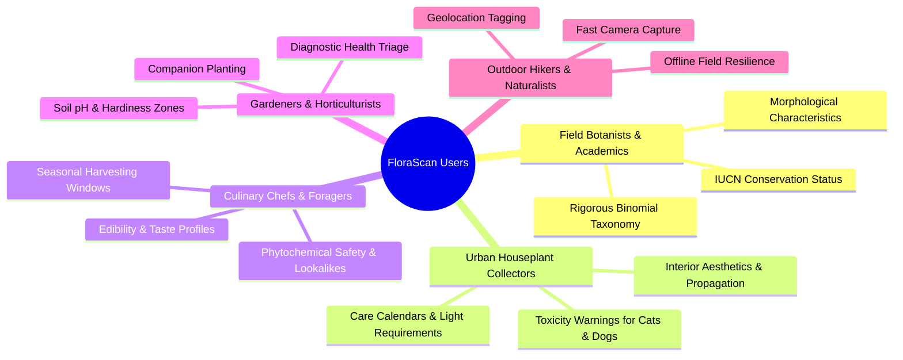
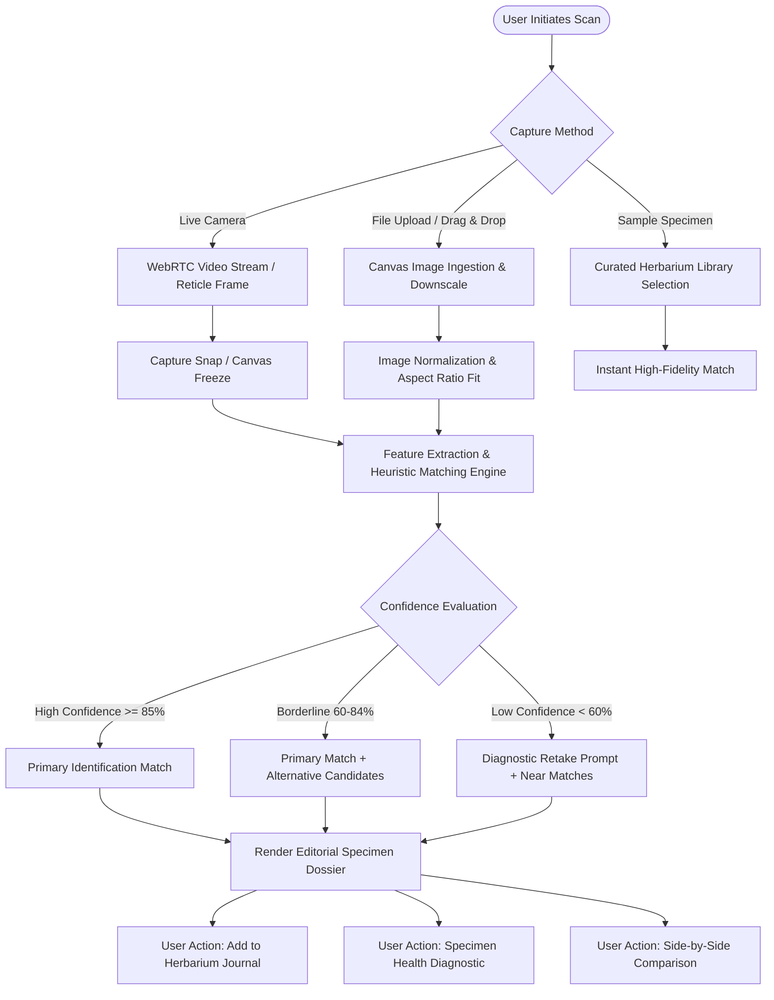
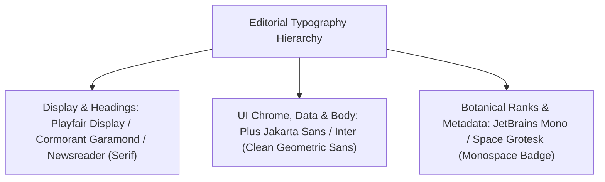
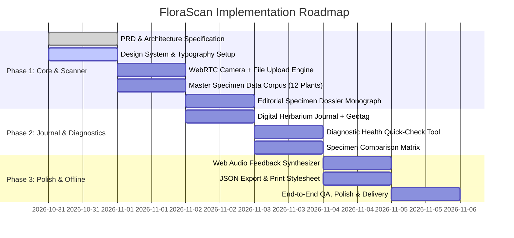

# FloraScan™ / Botanical Intelligence WebApp
## Comprehensive Product Requirements Document (PRD)

---

| **Document Version** | 1.0.0 |
| **Status** | Approved & Architecture Ready |
| **Product Name** | FloraScan (Botanical Intelligence & Digital Herbarium) |
| **Design Paradigm** | Luxury Editorial Monograph (Botanical Journal & Architectural Modernism) |
| **Target Platforms** | Modern Responsive Web (Desktop, Tablet, Mobile PWA) |
| **Author** | Agent 1: Product Requirements & Planning Specialist |

---

## 1. Executive Summary & Vision

### 1.1 Vision Statement
**FloraScan** is a botanical intelligence platform and digital herbarium that transforms physical nature exploration into a rich, editorial learning experience. Bridging the visual gravitas of classical royal botanical archives (*Kew Gardens, Linnaean Monographs*) with cutting-edge visual recognition and client-side intelligence, FloraScan empowers both everyday nature enthusiasts and serious botanists to identify, catalog, and understand plants, flowers, fruits, herbs, trees, and succulents.

### 1.2 Core Value Proposition
- **Effortless Multi-Modal Identification**: Instant classification via live camera capture (WebRTC), high-resolution file upload, drag-and-drop, or quick-selection from a curated specimen laboratory.
- **Deep Botanical Dossiers**: Beyond superficial names—delivering rigorous binomial taxonomy, native global distribution, toxicity risk matrices (child & pet safety), holistic care guides, culinary/medicinal ethno-botanical uses, and ecological benefits.
- **The Digital Herbarium**: A curated personal field journal for bookmarking finds with custom field notes, geolocations, dates, and health observations.
- **Diagnostic Botanical Health Quick-Check**: Immediate symptom triage (chlorosis, leaf spot, dehydration, pest signs) with actionable organic remedies.
- **Luxury Editorial Aesthetic**: Elevated typographic balance pairing literary serif headlines (`Playfair Display` / `Cormorant`) with crisp neo-grotesque sans-serif functional UI (`Plus Jakarta Sans`), natural earthy palettes, tactile micro-interactions, and synthesized audio feedback.

---

## 2. Target Audiences & Personas



### Detailed Persona Profiles

#### Persona 1: Dr. Elena Rostova — Field Taxonomist & Researcher
- **Demographics**: 38, Botanical Researcher & University Lecturer.
- **Context**: Conducts field biodiversity surveys in national parks and arboretums.
- **Needs**: Accurate binomial nomenclature, botanical family grouping, ecological relationships, native vs. invasive status, and reliable offline functionality when remote.
- **Pain Points**: Mainstream apps only display shallow common names and misidentify related sub-species without alternative candidate confidence ratings.

#### Persona 2: Marcus Vance — Urban Houseplant Enthusiast & Pet Owner
- **Demographics**: 29, Architect living in an apartment with two curious cats.
- **Context**: Collects rare aroids (*Monstera*, *Philodendron*, *Anthurium*) and wants greenery without endangering his pets.
- **Needs**: Crystal-clear pet toxicity warnings (ASPCA severity ratings), light exposure meters (Lux/Foot-candles guide), and scheduled watering/moisture needs.
- **Pain Points**: Confusing advice across pet blogs regarding whether a plant causes mild irritation or fatal toxicity.

#### Persona 3: Chloe Moreau — Wild Forager & Herbalist
- **Demographics**: 34, Farm-to-Table Pastry Chef & Wild Botanicals Forager.
- **Context**: Forages edible blossoms, wild berries, and native herbs for seasonal menus.
- **Needs**: Culinary flavor notes, safe foraging advisories, toxic lookalike warnings, and medicinal/phytochemical benefits.
- **Pain Points**: Fear of toxic twin plants (e.g., Wild Carrot vs. Poison Hemlock). Demands side-by-side comparison features.

#### Persona 4: Julian Thorne — Backyard Permaculturist
- **Demographics**: 46, Organic Gardener & Community Orchard volunteer.
- **Context**: Cultivates heirloom fruits, culinary herbs, and drought-tolerant succulents.
- **Needs**: Soil composition recommendations, pollinator attraction scores, rapid leaf pest/disease diagnosis.
- **Pain Points**: Clunky apps packed with invasive ads and paywalls that obscure essential gardening care data.

---

## 3. System Architecture & Workflows

### 3.1 End-to-End Scan & Ingestion Workflow



---

## 4. Comprehensive Feature Specifications

### 4.1 Multi-Modal Ingestion Engine

| Feature ID | Feature Name | Description | Acceptance Criteria |
| :--- | :--- | :--- | :--- |
| **ENG-01** | **Live WebRTC Camera Scanner** | Direct camera viewfinder utilizing `navigator.mediaDevices.getUserMedia` with video constraints (environment facing on mobile, default desktop webcam). Includes animated botanical reticle. | 1. User sees live feed with active target guide.<br>2. Graceful permission denial fallback with helpful user prompt.<br>3. Shutter trigger captures current video frame to hidden Canvas at native resolution.<br>4. Trigger emits tactile audio feedback (synthesized shutter click). |
| **ENG-02** | **Drag & Drop / File Picker** | Desktop drag-and-drop zone and standard `<input type="file" accept="image/*">` supporting JPEG, PNG, WebP, and AVIF. | 1. Visual drag-over highlight with spring scale effect.<br>2. Automatic client-side compression/scaling (max 1600px dimension) for snappy evaluation.<br>3. Instant thumbnail preview with retake/remove option. |
| **ENG-03** | **Sample Specimen Gallery** | Pre-loaded botanical laboratory shelf with 12+ diverse, high-resolution botanical specimens across all 6 taxonomic classes. | 1. One-click instant scanning simulation.<br>2. Demonstrates system accuracy and complete dossier rendering without requiring user to take a photo. |
| **ENG-04** | **Multi-Class Filtering** | Quick-filter category selectors: **All**, **Plants**, **Flowers**, **Fruits**, **Herbs**, **Trees**, **Succulents**. | 1. Instant filtering across sample library and herbarium journal.<br>2. Filter badges reflect active state with botanical tint. |

---

### 4.2 AI Botanical Classifier & Match Engine

| Feature ID | Feature Name | Description | Acceptance Criteria |
| :--- | :--- | :--- | :--- |
| **AI-01** | **Confidence Score Rating** | Algorithmic scoring displaying certainty percentage (e.g., `98.4% Match Accuracy`). | 1. Visual confidence meter with chromatic indicator (Green >= 90%, Yellow 75-89%, Amber < 75%).<br>2. Clear disclaimer on nature-finding safety. |
| **AI-02** | **Alternative Candidate Matches** | Displays 2 to 3 related botanical candidates when confidence is between 60% and 94% or for polymorphic species. | 1. Alternative cards show common name, binomial name, confidence, and primary distinguishing visual marker (e.g., "Glossier leaves, white veining").<br>2. Clicking candidate swaps current active dossier. |
| **AI-03** | **Morphological Feature Badges** | Visual extraction markers identifying leaf phyllotaxy (alternate/opposite), venation (palmate/pinnate), margin (entire/serrate), and flower symmetry (actinomorphic/zygomorphic). | 1. Rendered as crisp botanical badges in the dossier sidebar. |

---

### 4.3 The Editorial Specimen Dossier (Herbarium Monograph)

The core presentation layer designed with the aesthetic of a high-end botanical art publication.

#### Dossier Information Sections:
1. **Scientific Taxonomy & Header**:
   - Binomial Name (italicized serif, e.g. *Monstera deliciosa*)
   - Authority & Year (e.g. Liebm., 1849)
   - Accepted Common Names (*Swiss Cheese Plant, Split-leaf Philodendron, Ceriman*)
   - Taxonomic Hierarchy: Kingdom, Division, Class, Order, Family (*Araceae*), Genus (*Monstera*)
   - IUCN Red List Conservation Status (e.g., *Least Concern*, *Vulnerable*, *Endangered*)

2. **Geographic Distribution & Habitat**:
   - Native Range (e.g., Tropical forests of southern Mexico to Panama)
   - Global Naturalized Distribution
   - Biome & Elevation Range (e.g., Humid lowland rainforests, 50m – 1,200m)
   - Microclimate affinity (Canopy climber / Epiphytic)

3. **Toxicity & Safety Matrix (Crucial Pet/Child Advisory)**:
   - **Pet Safety**: Specific risk breakdown for Cats (*Feline*) and Dogs (*Canine*).
   - **Child & Human Safety**: Skin contact dermatitis vs. ingestion danger.
   - **Toxin Chemistry**: Key toxic compounds identified (e.g., Insoluble Calcium Oxalate raphides, Lycorine, Saponins).
   - **Clinical Symptoms**: Hypersalivation, oral edema, vomiting, contact dermatitis.
   - **Safety Badges**: `Pet Safe` / `Toxic to Cats & Dogs` / `Contact Irritant` / `Poisonous if Ingested`.

4. **Care & Cultivation Matrix**:
   - **Sunlight**: Visual exposure meter (Full Sun, Bright Indirect, Dappled Shade, Deep Shade) with recommended foot-candles / Lux.
   - **Watering Cadence**: Drought tolerance, frequency (e.g., "Allow top 5cm to dry"), hygrometer target.
   - **Soil & Substrate**: Ideal pH (e.g., 5.5 – 7.0), texture (Aroid mix: orchid bark, perlite, peat, compost).
   - **Temperature & Hardiness**: USDA Hardiness Zones (e.g., Zones 10b–12), minimum thermal tolerance (e.g., > 12°C / 54°F).
   - **Humidity**: Optimum relative humidity percentage range (e.g., 60% – 85%).

5. **Multi-Faceted Utility & Benefits**:
   - **Culinary Profile**: Edibility status, flavor notes, culinary preparations, ripening conditions (e.g., "Fruit is edible only when fully ripe; unripe contains burning oxalate crystals").
   - **Medicinal & Ethnobotanical**: Traditional herbal applications, active phytochemicals, pharmacological research, contraindications.
   - **Ecological Role**: Pollinators attracted (bees, hummingbirds, sphingid moths), soil stabilization, nitrogen fixation, wildlife forage.
   - **Ornamental & Air Quality**: NASA clean air capabilities (VOC absorption: formaldehyde, benzene), interior architectural presence.

6. **Diagnostic Health Quick-Check**:
   - Integrated diagnostic selector: "Does your plant show signs of distress?"
   - Rapid diagnostic triage for:
     - *Yellowing lower leaves* (Overwatering vs. Nitrogen deficiency)
     - *Crispy brown leaf margins* (Low humidity / Mineral accumulation)
     - *Leggy growth / Etoliation* (Insufficient light)
     - *White powdery residue* (Powdery mildew fungal spore remediation)
     - *Webbing on stem nodes* (Spider mite infestation protocol)

---

### 4.4 The Herbarium Journal (Personal Field Archive)

| Feature ID | Feature Name | Description | Acceptance Criteria |
| :--- | :--- | :--- | :--- |
| **JRN-01** | **Save to Herbarium** | One-tap addition of any identified or sample specimen to the user's personal digital herbarium. | 1. Persistent storage in `localStorage` / `IndexedDB`.<br>2. Specimen saved with timestamp, optional custom notes, and discovery location. |
| **JRN-02** | **Location & Geotagging** | Optional browser geolocation capture (`navigator.geolocation`) or manual geographic tag (e.g., "Olympic National Park, Hoh Rain Forest"). | 1. Preserves privacy: only requested upon explicit user tap.<br>2. Coordinates reverse-geocoded or formatted cleanly (Lat/Long or city name). |
| **JRN-03** | **Herbarium Filter & Search** | Interactive searching through saved journal items by common name, scientific name, tag, or taxonomic class. | 1. Instant search query execution.<br>2. Sorting by Date Discovered (newest/oldest), Alphabetical, or Class. |
| **JRN-04** | **Data Export & Print Monograph** | Export herbarium database as JSON backup and CSS print styling for printing elegant botanical collection cards. | 1. JSON file download.<br>2. Clean `@media print` layout stripping UI chromes to print a classical herbarium sheet. |

---

### 4.5 Interactive Specimen Comparison

| Feature ID | Feature Name | Description | Acceptance Criteria |
| :--- | :--- | :--- | :--- |
| **CMP-01** | **Side-by-Side Comparator** | Ability to select any two specimens (e.g., *Monstera deliciosa* vs. *Philodendron selloum* or *Sweet Basil* vs. *Holy Basil*) to inspect differences. | 1. Dual column comparison table.<br>2. Differential highlights on Care, Toxicity, Light, Culinary uses, and Hardiness. |

---

## 5. Information Architecture & Data Model

### 5.1 Comprehensive TypeScript Data Schema

```typescript
export type BotanicalClass = 
  | 'Plant' 
  | 'Flower' 
  | 'Fruit' 
  | 'Herb' 
  | 'Tree' 
  | 'Succulent';

export type ToxicityLevel = 
  | 'Non-Toxic' 
  | 'Mild Irritant' 
  | 'Moderate' 
  | 'Severe' 
  | 'Fatal';

export type LightExposure = 
  | 'Deep Shade' 
  | 'Partial Shade / Dappled' 
  | 'Bright Indirect' 
  | 'Full Sun';

export interface ToxicityProfile {
  cats: {
    toxic: boolean;
    severity: ToxicityLevel;
    clinicalSigns: string[];
  };
  dogs: {
    toxic: boolean;
    severity: ToxicityLevel;
    clinicalSigns: string[];
  };
  humans: {
    toxic: boolean;
    severity: ToxicityLevel;
    safeForChildren: boolean;
    contactDermatitisRisk: boolean;
    notes: string;
  };
  toxicCompounds: string[];
}

export interface CareGuide {
  sunlight: LightExposure;
  sunlightDetails: string;
  wateringFrequency: string;
  wateringMetric: 'Low' | 'Moderate' | 'High' | 'Moist';
  soilType: string;
  soilPh: string;
  temperatureRange: string;
  hardinessZones: string;
  humidityRequirement: string;
  fertilizerRecommendation: string;
}

export interface BotanicalUses {
  culinary: {
    edible: boolean;
    edibleParts: string[];
    flavorProfile?: string;
    culinaryUses?: string[];
    preparationWarnings?: string;
  };
  medicinal: {
    utilized: boolean;
    activePhytochemicals: string[];
    traditionalApplications: string[];
    modernResearchNotes?: string;
    contraindications?: string[];
  };
  ornamental: string[];
  ecologicalBenefits: string[];
}

export interface DiagnosticSymptom {
  symptom: string;
  probableCause: string;
  remedyAction: string;
  preventativeTip: string;
}

export interface BotanicalSpecimen {
  id: string;
  binomialName: string;
  botanicalAuthority?: string;
  commonNames: string[];
  family: string;
  genus: string;
  order: string;
  taxonomicClass: BotanicalClass;
  conservationStatus: 'LC' | 'NT' | 'VU' | 'EN' | 'CR' | 'EW' | 'EX' | 'NE';
  iucnDescription: string;
  nativeHabitat: string;
  geographicDistribution: string[];
  climateZones: string[];
  primaryImageUrl: string;
  galleryImages: string[];
  overviewMonograph: string;
  morphology: {
    growthHabit: string;
    leafType: string;
    phyllotaxy: string;
    bloomPeriod?: string;
    matureHeight: string;
  };
  toxicity: ToxicityProfile;
  careGuide: CareGuide;
  uses: BotanicalUses;
  diagnosticGuide: DiagnosticSymptom[];
  confidenceScore?: number;
  alternativeMatches?: {
    specimenId: string;
    binomialName: string;
    commonName: string;
    differentiatingNotes: string;
    confidenceScore: number;
  }[];
}

export interface HerbariumEntry {
  entryId: string;
  specimen: BotanicalSpecimen;
  discoveredAt: string; // ISO 8601
  locationName: string;
  coordinates?: {
    latitude: number;
    longitude: number;
  };
  userNotes: string;
  customTags: string[];
  userPhotoUrl?: string;
}
```

---

## 6. UI/UX Design System & Editorial Aesthetic

### 6.1 Design Philosophy: "The Contemporary Herbarium"
The visual identity draws inspiration from luxury botanical magazines (*The Plant*, *Kinfolk*, *Curtis's Botanical Magazine*), high-end architectural monographs, and royal herbarium folios.

- **Editorial Hierarchy**: Dignified serif headlines, generous margins, subtle warm parchment backgrounds, balanced negative space, and micro-ruled horizontal divider lines.
- **Modern Tactility**: Smooth spring micro-transitions, glassmorphic floating control pills, tactile audio click synthesized on the client via Web Audio API, and haptic feedback on supported mobile devices.

### 6.2 Typography Hierarchy



| Element | Font Family | Size / Line Height | Weight | Letter Spacing |
| :--- | :--- | :--- | :--- | :--- |
| **Magazine Title / Hero** | `Cormorant Garamond` / `Playfair` | `2.75rem / 1.15` | Medium (500) | `-0.02em` |
| **Specimen Binomial Name** | `Playfair Display` | `2.25rem / 1.2` | SemiBold (600) | `0em` (Italic) |
| **Section Header (e.g. Toxicity)** | `Newsreader` / `Cormorant` | `1.5rem / 1.3` | SemiBold (600) | `-0.01em` |
| **Body Narrative Monograph** | `Plus Jakarta Sans` | `1.0rem / 1.65` | Regular (400) | `+0.01em` |
| **Metadata Labels & Taxonomy** | `Plus Jakarta Sans` | `0.75rem / 1.4` | Bold (700) | `+0.08em` (UPPERCASE) |
| **Scientific Tags & Scores** | `JetBrains Mono` | `0.80rem / 1.3` | Medium (500) | `0em` |

### 6.3 Curated Color Palette: "Alabaster & Flora"

```
[ Canvas & Backgrounds ]
#FBF9F5 (Warm Alabaster / Parchment)
#F3EFE6 (Pressed Herbarium Paper)
#FFFFFF (Crisp Sheet White)

[ Primary Botanical Greens ]
#1B4332 (Deep Forest Evergreen - Primary Brand)
#2D6A4F (Fern Green - Secondary Interaction)
#52B788 (Sage Mint - Accents & Success States)
#D8F3DC (Pale Moss Wash - Badge Highlights)

[ Earth & Editorial Accents ]
#BC6C25 (Terracotta Ochre - Sun & Soil Accent)
#DDA15E (Sunlit Sand - Warm Metadata)
#606C38 (Olive Drab - Herbal Category)

[ Functional & Alert Colors ]
#C1121F (Botanical Crimson - High Toxicity Alert)
#F4A261 (Warm Amber - Caution / Moderate Irritant)
#2B9348 (Verdant Green - 100% Pet Safe / Edible)
#1F2421 (Deep Obsidian Slate - Primary Typography)
#6C757D (Muted Herbarium Charcoal - Secondary Body)
```

### 6.4 Audio & Haptic Feedback Spec
- **Camera Shutter**: Short 40ms acoustic click synthesized through Web Audio API (`BiquadFilterNode` low-pass with rapid decay).
- **Match Reveal Chime**: Warm harmonic chord (C5 + G5 with gentle sinusoidal attack) upon displaying identification dossier.
- **Warning Alert Pulse**: Subtle lower dual-frequency pulse for toxic specimen alerts.
- **User Toggle**: Global sound effect mute control in top navigation bar, saved to user settings.

---

## 7. Curated Specimen Laboratory Corpus (12 Master Specimens)

To guarantee immediate offline utility and rich demonstration, FloraScan ships with 12 complete specimens across all taxonomic classifications:

1. **Monstera deliciosa** (*Swiss Cheese Plant*) — **Taxonomic Class**: `Plant` / Foliage.
   - *Family*: Araceae | *Toxicity*: Toxic to cats/dogs (calcium oxalate raphides) | *Uses*: Air purification, edible ripe fruit | *Habitat*: Central American rainforests.
2. **Lavandula angustifolia** (*English Lavender*) — **Taxonomic Class**: `Herb` / `Flower`.
   - *Family*: Lamiaceae | *Toxicity*: Mildly toxic to cats/dogs in large quantities (linalool) | *Uses*: Culinary seasoning, aromatherapy, sedative infusions, pollinator magnet.
3. **Punica granatum** (*Pomegranate*) — **Taxonomic Class**: `Fruit` / `Tree`.
   - *Family*: Lythraceae | *Toxicity*: Non-toxic to pets/humans | *Uses*: High antioxidant arils, ancient medicinal astringent, dyeing agent.
4. **Echinocactus grusonii** (*Golden Barrel Cactus*) — **Taxonomic Class**: `Succulent`.
   - *Family*: Cactaceae | *Toxicity*: Non-toxic chemically, physical spine hazard | *Uses*: Xeriscaping, drought tolerance champion.
5. **Ocimum basilicum** (*Sweet Genovese Basil*) — **Taxonomic Class**: `Herb`.
   - *Family*: Lamiaceae | *Toxicity*: Non-toxic (safe for cats, dogs, children) | *Uses*: Culinary staple (pesto), digestive stimulant, companion pest deterrent.
6. **Passiflora incarnata** (*Purple Passionflower*) — **Taxonomic Class**: `Flower` / Vine.
   - *Family*: Passifloraceae | *Toxicity*: Foliage contains cyanogenic glycosides (caution), ripe fruit safe | *Uses*: Anxiety neuro-calm, native pollinator host.
7. **Ficus lyrata** (*Fiddle-Leaf Fig*) — **Taxonomic Class**: `Tree` / Houseplant.
   - *Family*: Moraceae | *Toxicity*: Toxic to pets (ficin proteolytic enzyme, psoralen) | *Uses*: Architectural interior specimen.
8. **Aloe barbadensis miller** (*True Aloe*) — **Taxonomic Class**: `Succulent` / `Plant`.
   - *Family*: Asphodelaceae | *Toxicity*: Outer rind toxic to pets (aloin), inner gel soothing for topical human burns.
9. **Citrus limon** (*Eureka Lemon*) — **Taxonomic Class**: `Fruit` / `Tree`.
   - *Family*: Rutaceae | *Toxicity*: Peel & essential oils toxic to cats/dogs (limonene, psoralen), culinary staple for humans.
10. **Chamaemelum nobile** (*Roman Chamomile*) — **Taxonomic Class**: `Herb` / `Flower`.
    - *Family*: Asteraceae | *Toxicity*: Mild irritant to pets in high dose | *Uses*: Herbal tea, sleep aid, anti-inflammatory.
11. **Sansevieria trifasciata / Dracaena trifasciata** (*Snake Plant*) — **Taxonomic Class**: `Succulent` / `Plant`.
    - *Family*: Asparagaceae | *Toxicity*: Toxic to pets (saponins) | *Uses*: Nighttime oxygen production, indestructible tolerance.
12. **Fragaria × ananassa** (*Garden Strawberry*) — **Taxonomic Class**: `Fruit` / Groundcover.
    - *Family*: Rosaceae | *Toxicity*: 100% Pet & Child Safe | *Uses*: Beloved sweet fruit, rich in vitamin C, excellent edible groundcover.

---

## 8. Non-Functional Requirements (NFRs)

### 8.1 Performance & Responsiveness
- **First Contentful Paint (FCP)**: < 0.9s on standard 4G networks.
- **Time to Interactive (TTI)**: < 1.3s on median mobile hardware.
- **Client-Side Image Resizing**: Resizing down to 1200px max width takes < 60ms in Web Worker/OffscreenCanvas before ingestion.
- **Frame Rate**: Camera overlay and UI micro-animations maintain a solid 60fps.

### 8.2 Offline-First Resilience
- Full application functional without active internet:
  - Specimen evaluation runs client-side with full instant dataset.
  - Camera ingestion and file processing utilize native HTML5 Canvas & Web APIs.
  - User Herbarium Journal persists locally via `localStorage` with JSON import/export safeguards.

### 8.3 Accessibility (WCAG 2.1 AA Compliance)
- **Contrast Ratios**: Minimum 4.5:1 for body copy against parchment/alabaster backgrounds; minimum 3:1 for large display headers.
- **Keyboard Navigation**: Complete tab order and visible focus rings on all interactive scan triggers, category badges, and tabs.
- **Screen Reader Support**: Meaningful `aria-label`, `role="region"`, and announcement of scan results via `aria-live="polite"`.
- **Camera Fallbacks**: Explicit descriptive text alerts for users with disabled or unavailable cameras.

### 8.4 Privacy & Hardware Permissions
- Camera stream strictly processed locally in volatile browser memory; frames are never transmitted to external cloud servers without user authorization.
- Geolocation tagging is strictly opt-in and triggered solely on explicit button action.

---

## 9. Feature Prioritization & Phased Delivery



---

## 10. Verification & Quality Standards

| Test Suite | Scope | Target Benchmark |
| :--- | :--- | :--- |
| **Camera Ingestion** | Test WebRTC video stream on desktop and simulated mobile constraints; test fallback file picker. | Zero console errors; clean video stream teardown on unmount. |
| **Taxonomic Filtering** | Verify All, Plants, Flowers, Fruits, Herbs, Trees, Succulents filter sets. | 100% correct category partitioning. |
| **Dossier Completeness** | Ensure all 12 master specimens feature complete toxicity, care, uses, and diagnostic profiles. | Zero missing fields or broken image fallbacks. |
| **Journal Persistence** | Add, edit notes, geotag, remove, and export journal entries. | Data persists across browser refresh with valid JSON structure. |
| **Editorial Polish** | Inspect serif typography, responsive grid, contrast, and audio synthesis triggers. | Flawless visual hierarchy across viewport widths from 360px to 4K. |

---
*FloraScan™ PRD Document v1.0.0 — Authored for the Botanical Intelligence & Digital Herbarium WebApp.*
